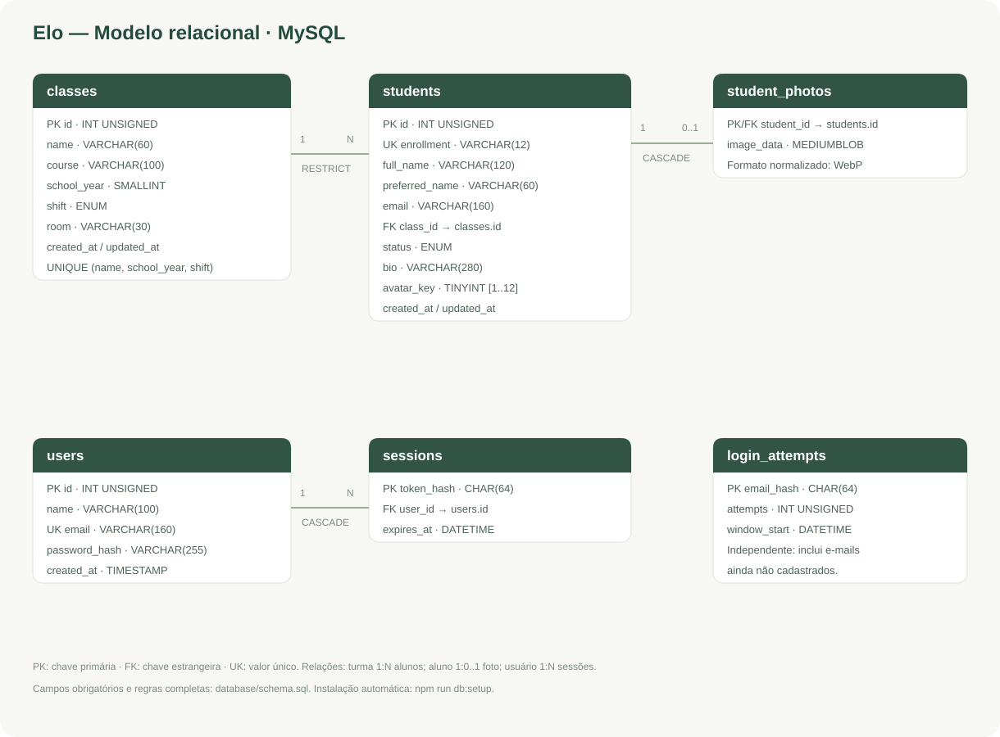

# Elo — Carômetro escolar

**Pessoas, antes de números.** Aplicação web para reconhecer alunos pelos rostos, organizar turmas e consultar os cadastros da comunidade escolar. Projeto acadêmico com Next.js, TypeScript e **MySQL real**, executado localmente.

## Funcionalidades

- **Alunos:** cadastro, listagem, perfil, edição e exclusão com confirmação; matrícula única; nome de preferência, e-mail, apresentação e situação acadêmica.
- **Turmas:** cadastro, consulta, edição, exclusão e acesso ao carômetro filtrado; nome, curso, ano, turno e sala.
- **Retratos:** upload de JPG, PNG ou WebP até 3 MB; substituição e remoção; 12 ilustrações locais de pessoas fictícias como alternativa.
- **Consulta:** nome, nome de preferência ou matrícula; filtros combinados por turma e situação; ordenação e paginação de 12 alunos no servidor.
- **Interface:** cartões ou lista, indicadores reais, adaptação a celular/tablet, estados de carregamento, telas vazias, mensagens claras e impressão da página visível.
- **Login:** sessão revogável de 8 horas, senha com scrypt e limite persistente de tentativas.
- **Demonstração:** 4 turmas e 24 alunos fictícios, criados automaticamente na primeira instalação.

## Tecnologias e decisões

| Tecnologia                  | Uso e motivo                                                                                    |
| --------------------------- | ----------------------------------------------------------------------------------------------- |
| Next.js 16.4.6 / App Router | Páginas, navegação e API no mesmo projeto; não exige um segundo servidor de aplicação.          |
| React 19 / TypeScript       | Componentes e contratos tipados; tipos ajudam no desenvolvimento, validação protege a execução. |
| MySQL 8 / InnoDB            | Persistência, chaves estrangeiras, índices, restrições e transações.                            |
| mysql2                      | Prepared statements e pool; SQL explícito para facilitar o estudo.                              |
| Zod                         | Regras compartilhadas entre formulário e API; servidor valida sempre.                           |
| Sharp                       | Decodifica imagens de verdade, reduz tamanho, converte para WebP e remove metadados.            |
| Node.js crypto              | scrypt para senhas, tokens aleatórios e SHA-256 para os hashes das sessões.                     |
| CSS / Lucide                | Estilo responsivo próprio e ícones, sem depender de fontes ou fotos remotas.                    |

O `overrides` do package.json mantém o Sharp corrigido também nas dependências transitivas do Next.js, evitando carregar outra versão antiga para processamento de imagens.

## Pré-requisitos

1. **Node.js 22 ou superior**, com npm. Verifique com `node -v` e `npm -v`.
2. **MySQL Community Server 8.0.16 ou superior**, recomendado **8.4**, iniciado e acessível por TCP. MySQL Workbench sozinho **não é o servidor**.
3. Uma conta MySQL administrativa capaz de criar banco e usuário, usada apenas durante o setup.
4. Internet para instalar os pacotes na primeira vez. Depois, os fluxos do app e retratos fictícios funcionam sem internet.

Não utiliza SQLite, banco em memória, Ollama ou serviços pagos. O XAMPP normalmente traz MariaDB, que não é o MySQL solicitado neste projeto: instale MySQL Community ou use a opção Docker abaixo.

## Instalação local

Abra o terminal **na pasta que contém este README e o package.json**.

```bash
npm ci
```

Copie `.env.example` para `.env`:

```powershell
# Windows / PowerShell
Copy-Item .env.example .env
```

```bash
# Linux / macOS
cp .env.example .env
```

Abra `.env` em um editor e preencha os dados do seu MySQL. Exemplo de configuração local:

```dotenv
DB_HOST=127.0.0.1
DB_PORT=3306
DB_NAME=elo_carometro
DB_ADMIN_USER=root
DB_ADMIN_PASSWORD=sua_senha_do_mysql
DB_USER=elo_app
DB_PASSWORD=uma_senha_local_com_8_ou_mais_caracteres
DEMO_EMAIL=professor@elo.local
DEMO_PASSWORD=Elo@2026!
COOKIE_SECURE=false
DEMO_ACCESS=false
TEST_BASE_URL=http://localhost:3000
```

`DB_ADMIN_*` pertence à instalação/configuração. A aplicação usa **somente `DB_USER` e `DB_PASSWORD`**, uma conta com SELECT, INSERT, UPDATE e DELETE apenas na base do projeto. `.env` está no `.gitignore` e nunca deve ir para o GitHub.

Com o MySQL iniciado, execute:

```bash
npm run db:setup
npm run dev
```

Acesse **http://localhost:3000**. O setup cria o banco, as 6 tabelas, a conta limitada, o login e os registros de demonstração. Não precisa importar SQL manualmente. Reexecutar o setup não apaga dados, não redefine senhas existentes e só popula as turmas/alunos quando ainda não há turmas. Se a conta `elo_app` já existir, informe sua senha atual em `DB_PASSWORD`.

**No Windows:** `CONFIGURAR.cmd` orienta a edição do `.env`, instala os pacotes e configura o banco. Depois, `INICIAR.cmd` inicia o app. Ambos procuram Node no PATH, em `C:\Program Files\nodejs`, na instalação por usuário e aceitam um caminho informado manualmente. Os comandos de terminal acima continuam sendo a forma universal de execução.

## MySQL com Docker (opcional)

Se já tiver Docker Desktop instalado e aberto, pode dispensar a instalação manual do MySQL:

1. Copie `.env.example` para `.env`.
2. Defina uma senha em `DB_ADMIN_PASSWORD`. Mantenha `DB_ADMIN_USER=root`, `DB_HOST=127.0.0.1` e `DB_PORT=3306`.
3. Execute:

```bash
docker compose up -d --wait
npm ci
npm run db:setup
npm run dev
```

O volume `elo_mysql` preserva os dados entre reinícios. `docker compose down` para o serviço sem apagar o volume. Se a porta 3306 estiver ocupada, use, por exemplo, `DB_PORT=3307` no `.env` antes de subir o container. Em volume existente, alterar `DB_ADMIN_PASSWORD` no arquivo **não altera** a senha que já foi gravada pelo MySQL.

## Acesso de demonstração

| Campo  | Valor inicial         |
| ------ | --------------------- |
| E-mail | `professor@elo.local` |
| Senha  | `Elo@2026!`           |

Esses valores podem ser definidos no `.env` **antes do primeiro setup**. A aplicação não tem recuperação de senha nem cadastro público de contas. Rodar o seed novamente não redefine a senha de um usuário que já existe.

Para uma apresentação com **somente dados fictícios**, é possível definir `DEMO_ACCESS=true` e reiniciar o servidor. A tela exibirá **Acessar demonstração**, que entra na conta fictícia sem digitar senha. O padrão é `false`; manter desativado sempre que houver dados reais, pois o botão dá acesso completo aos cadastros.

## Execução para apresentar

O modo desenvolvimento permite alterar o código. Para apresentar uma versão compilada:

```bash
npm run build
npm start
```

O MySQL precisa continuar iniciado. O build pode ser feito sem conectar ao banco; as consultas ocorrem quando as páginas/API são usadas. Use `Ctrl+C` no terminal para parar o Next.js. Para mostrar em um celular conectado à mesma rede, abra `http://IP_DO_COMPUTADOR:3000`; pode ser necessário liberar a porta no firewall da rede. Não exponha o banco MySQL à internet.

## Testes

```bash
npm test
npm run typecheck
npm run build
```

Os testes de validação não exigem MySQL. Para o teste real de HTTP e persistência, mantenha MySQL e aplicação iniciados, confira `TEST_BASE_URL` no `.env` e abra **outro terminal**:

```bash
npm run test:integration
```

Esse teste entra pela API, cria uma turma/aluno exclusivos, valida restrições, envia uma imagem PNG real, edita o cadastro, consulta diretamente por outra conexão MySQL, exclui seus registros e testa a revogação de sessão. Ele não exclui os alunos da demonstração. Ao falhar tenta limpar os registros criados por ele. Execute na sua base de desenvolvimento.

A automação em `.github/workflows/ci.yml` executa validação, TypeScript, build e integração com um serviço MySQL 8.4 no GitHub Actions. Não depende de secrets do repositório: usa credenciais de teste descartáveis do próprio job.

Resultados observados e limites da verificação: [docs/TESTES.md](docs/TESTES.md).

## Modelo do banco



- Uma **turma** tem zero ou muitos alunos. Cada **aluno** pertence a exatamente uma turma. FK `RESTRICT` impede excluir turmas com alunos.
- Um aluno tem zero ou uma **foto**. A PK da foto é também FK para o aluno; `CASCADE` exclui a foto quando o aluno é removido.
- Um **usuário** pode ter várias **sessões**. Ao excluir uma conta, suas sessões são removidas por `CASCADE`.
- `login_attempts` é uma tabela técnica independente, indexada pelo hash do e-mail, para contar tentativas.
- Matrícula e e-mail de login são únicos; a combinação nome/ano/turno identifica uma turma; enums limitam situação e turno; checks limitam ano e chave da ilustração.

O SQL completo está em [database/schema.sql](database/schema.sql), e o dicionário de dados e diagrama Mermaid em [docs/BANCO_DE_DADOS.md](docs/BANCO_DE_DADOS.md).

## Organização e leitura do código

| Caminho           | Responsabilidade                                                                                            |
| ----------------- | ----------------------------------------------------------------------------------------------------------- |
| `src/app/`        | Rotas, layouts, páginas e CSS global. O grupo `(app)` compartilha o layout autenticado sem aparecer na URL. |
| `src/app/api/`    | Entradas HTTP do backend. Autenticação, validação e respostas padronizadas.                                 |
| `src/components/` | Interface e interações: formulários, cartões, diálogos, navegação e notificações.                           |
| `src/lib/`        | Regras reutilizáveis, tipos, banco, sessão, tratamento HTTP e fotos/transações.                             |
| `database/`       | Definição das tabelas e restrições.                                                                         |
| `scripts/`        | Instalação do banco, dados fictícios e inicialização.                                                       |
| `public/avatars/` | Ilustrações SVG locais, criadas para o projeto.                                                             |
| `tests/`          | Testes de validação e integração.                                                                           |
| `docs/`           | Modelo de dados, estudo do código, apresentação e contribuições.                                            |

**Comece por [docs/GUIA_DO_CODIGO.md](docs/GUIA_DO_CODIGO.md).** Ele explica o caminho do formulário ao MySQL, as funções de cada arquivo e os conceitos necessários para defender as decisões. O código está comentado em português; comentários explicam principalmente motivos e partes que exigem cuidado.

## GitHub e histórico de desenvolvimento

O pacote inclui `historico.git.bundle` com os commits das etapas reais desta implementação: configuração, modelo MySQL, API, interface, correções/testes e documentação. O histórico não simula dias de trabalho nem contribuições dos integrantes. Para continuar com esse histórico:

```bash
git clone historico.git.bundle elo-carometro
cd elo-carometro
```

```bash
# Depois de clonar o bundle e entrar na pasta clonada:
git remote remove origin
# Crie no GitHub um repositório vazio, sem README, e use a URL dele:
git remote add origin https://github.com/SEU_USUARIO/elo-carometro.git
git push -u origin main
```

Se estiver usando diretamente o ZIP sem recuperar o histórico, consulte [docs/GITHUB.md](docs/GITHUB.md). Durante o desenvolvimento do grupo, façam commits pequenos após mudanças reais e preencham [docs/CONTRIBUICOES.md](docs/CONTRIBUICOES.md) com o trabalho efetivamente feito por cada integrante.

## Resolução de problemas

| Sintoma                   | O que conferir                                                                                                           |
| ------------------------- | ------------------------------------------------------------------------------------------------------------------------ |
| Node não encontrado       | Instale Node.js 22+ e reabra o terminal; os CMDs aceitam a pasta do Node.                                                |
| MySQL indisponível        | Serviço iniciado, `DB_HOST`, `DB_PORT` e container saudável, se usar Docker.                                             |
| Acesso negado             | Senhas corretas no `.env`; usuário administrativo com permissão; senha atual de `elo_app` se já existe.                  |
| Banco/tabela inexistente  | Execute `npm run db:setup` antes de entrar.                                                                              |
| Conta demo não entra      | Use o e-mail/senha definidos antes do primeiro setup; seed não troca senha existente. Após 5 falhas, aguarde 15 minutos. |
| Cadastro não aparece      | Limpe a busca e os filtros; verifique paginação e ordenação.                                                             |
| Foto recusada             | JPG, PNG ou WebP real, até 3 MB, até 20 milhões de pixels; não basta renomear a extensão.                                |
| Não consigo excluir turma | Transfira ou exclua os alunos vinculados antes. O MySQL protege esse relacionamento.                                     |
| Porta 3000 ocupada        | Use `npm run dev -- --port 3001`; atualize `TEST_BASE_URL` para testar.                                                  |
| Volta ao login            | Sessão expirada, serviço MySQL parado ou `COOKIE_SECURE=true` em HTTP; para localhost HTTP use `false`.                  |

## Limitações conhecidas

- Escopo acadêmico para execução local; não é um sistema institucional pronto para produção.
- Um único perfil de gestão com permissão completa. Não há autoatendimento, permissões por turma, recuperação de senha ou trilha de auditoria.
- Sem reconhecimento facial: a identificação é visual/humana, pelas fotos e nomes.
- Não há histórico de matrículas: transferência altera a turma atual do aluno.
- Busca parcial usa `LOCATE`, adequada ao volume escolar de demonstração; milhares de registros podem exigir busca indexada específica. Turmas são filtradas no cliente.
- Fotos ficam no MySQL, simplificando backup e consistência; grandes volumes podem justificar armazenamento de arquivos separado.
- A impressão contém somente a página visível do carômetro; não é exportação de todos os alunos.
- A conta limitada é criada com host `%` para compatibilidade local/Docker; a porta do banco deve continuar restrita à máquina/rede autorizada.
- A limitação de login é por e-mail, não um sistema distribuído contra abuso. Exclusões são definitivas após confirmação.
- Setup inicial cria estrutura, mas não é um sistema de migrations para alterações futuras do schema.
- Scripts CMD são auxiliares para Windows; testes automatizados foram executados em Linux com Node 24 e MySQL 8.4.

## Apresentação

[Roteiro completo e perguntas esperadas](docs/APRESENTACAO.md). Demonstre uma gravação, uma busca posterior e uma edição persistida — inclusive recarregando a página. Cada integrante deve estudar o fluxo inteiro e explicar sua contribuição real.

## Referências oficiais

- [Next.js — Route Handlers](https://nextjs.org/docs/app/getting-started/route-handlers)
- [Next.js — Cookies](https://nextjs.org/docs/app/api-reference/functions/cookies)
- [MySQL2 — Prepared statements](https://sidorares.github.io/node-mysql2/docs/documentation/prepared-statements)
- [MySQL 8.4 — Foreign keys](https://dev.mysql.com/doc/refman/8.4/en/create-table-foreign-keys.html)
- [Node.js — scrypt](https://nodejs.org/api/crypto.html#cryptoscryptpassword-salt-keylen-options-callback)
