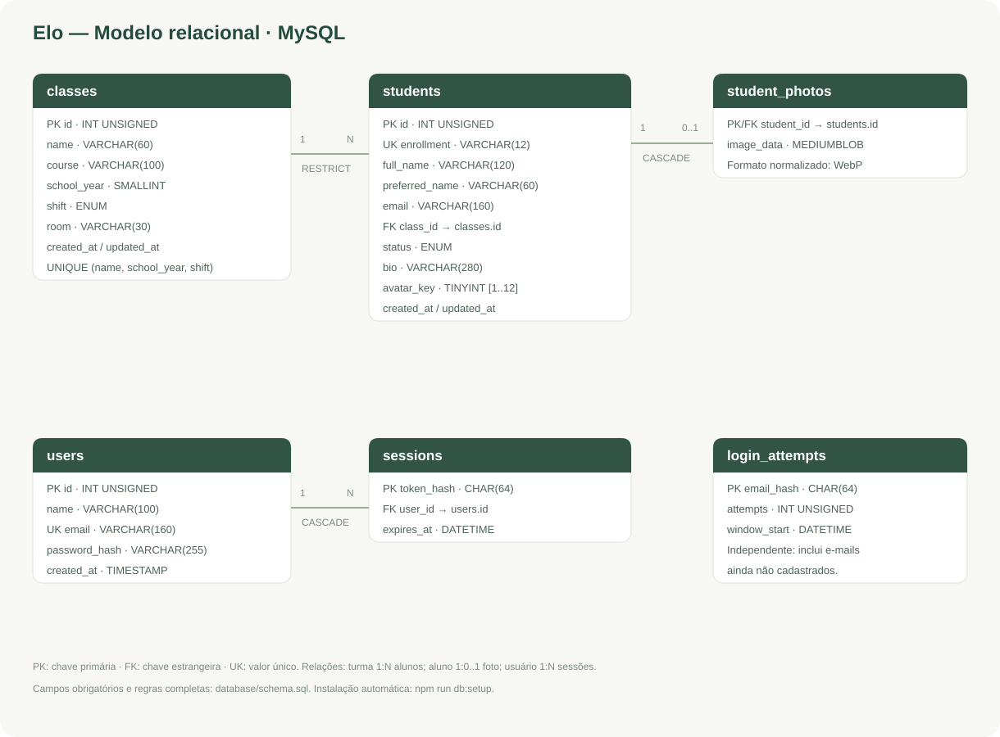
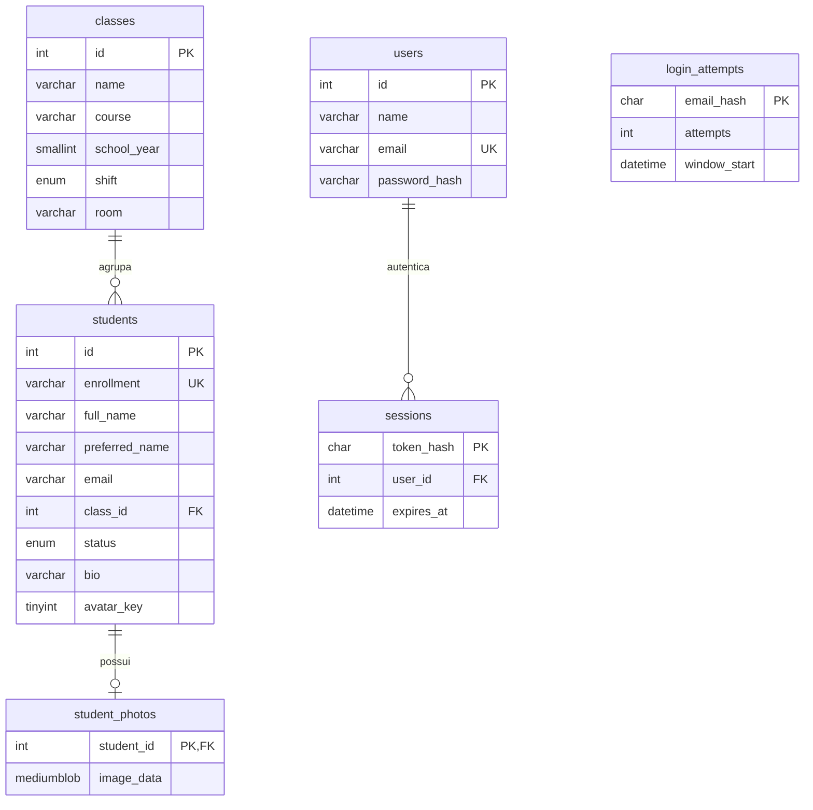

# Modelo do banco — Elo

A implementação usa MySQL 8.0.16+ (recomendado 8.4), InnoDB e `utf8mb4_0900_ai_ci`. O charset preserva português; a collation faz comparações sem diferenciar maiúsculas/minúsculas e acentos. O esquema completo, com os tamanhos e regras efetivos, está em `database/schema.sql`.



## Relacionamentos



`login_attempts` é independente de `users`: precisa contar tentativas mesmo para um e-mail que não existe.

## Dicionário de dados

| Tabela         | Campo                   | Finalidade / regra                                                                        |
| -------------- | ----------------------- | ----------------------------------------------------------------------------------------- |
| classes        | id                      | PK inteira, positiva, auto_increment.                                                     |
| classes        | name                    | Nome da turma, até 60 caracteres.                                                         |
| classes        | course                  | Curso, até 100 caracteres.                                                                |
| classes        | school_year             | Ano letivo entre 2000 e 2100 (CHECK no banco).                                            |
| classes        | shift                   | ENUM: Manhã, Tarde, Noite, Integral.                                                      |
| classes        | room                    | Sala/laboratório opcional, até 30 caracteres, vazio em vez de NULL.                       |
| classes        | created_at / updated_at | Datas automáticas de criação e atualização.                                               |
| students       | id                      | PK independente da matrícula; editar matrícula não altera o id.                           |
| students       | enrollment              | UNIQUE, até 12 caracteres. API exige de 4 a 12 números. String preserva zeros à esquerda. |
| students       | full_name               | Nome completo obrigatório, até 120 caracteres.                                            |
| students       | preferred_name          | Nome de preferência opcional, até 60 caracteres.                                          |
| students       | email                   | E-mail opcional, até 160 caracteres; não é conta de acesso.                               |
| students       | class_id                | FK obrigatória para classes.id, ON DELETE RESTRICT.                                       |
| students       | status                  | ENUM: Ativo, Trancado, Concluído.                                                         |
| students       | bio                     | Apresentação opcional de até 280 caracteres.                                              |
| students       | avatar_key              | Número de 1 a 12, validado com CHECK. Identifica um SVG local.                            |
| students       | created_at / updated_at | Datas automáticas; a API atualiza updated_at também ao mudar a foto.                      |
| student_photos | student_id              | PK e FK para students.id, ON DELETE CASCADE. No máximo uma foto por aluno.                |
| student_photos | image_data              | Bytes da imagem normalizada em WebP. Não armazena caminho externo.                        |
| users          | id / name               | Identificador e nome do responsável pela gestão.                                          |
| users          | email                   | UNIQUE. Identificador do login.                                                           |
| users          | password_hash           | Sal aleatório e derivação scrypt, em hexadecimal. Nunca a senha original.                 |
| users          | created_at              | Data automática de criação da conta.                                                      |
| sessions       | token_hash              | SHA-256 do token aleatório, PK de 64 caracteres.                                          |
| sessions       | user_id                 | FK para users.id; várias sessões por conta. CASCADE na exclusão da conta.                 |
| sessions       | expires_at              | Expiração conferida a cada consulta autenticada.                                          |
| login_attempts | email_hash              | SHA-256 do e-mail normalizado, inclusive se a conta não existe.                           |
| login_attempts | attempts                | Número de tentativas na janela atual.                                                     |
| login_attempts | window_start            | Início da janela de 15 minutos.                                                           |

Campos textuais opcionais de domínio usam string vazia por simplicidade dos formulários. Ausência de foto significa ausência da linha em `student_photos`, não um BLOB vazio.

## Integridade demonstrável

1. Matrícula duplicada: o MySQL recusa `UNIQUE`; a API devolve 409 e uma mensagem compreensível.
2. Aluno sem turma válida: a FK recusa a gravação; a transação é desfeita.
3. Excluir turma com alunos: `RESTRICT` mantém a turma. A verificação no banco funciona até se duas pessoas usarem o sistema simultaneamente.
4. Excluir aluno com foto: `CASCADE` remove os bytes da foto junto com o aluno.
5. Nome de turma repetido no mesmo ano e turno: combinação `UNIQUE(name,school_year,shift)` recusa. O mesmo nome em outro turno/ano é permitido.
6. Aluno/foto: `BEGIN`, gravações e `COMMIT` confirmam o conjunto; `ROLLBACK` desfaz em caso de falha.

## Normalização e índices

O curso e turno ficam na turma, e não são copiados em cada aluno. Um `JOIN` recupera essas informações ao consultar o aluno, evitando divergência quando a turma muda. `student_photos` separa BLOBs da tabela mais consultada. Índices em nome, turma/situação e expiração ajudam consultas; `LOCATE` de nome parcial ainda faz varredura e não aproveita plenamente o índice de nome.

`COUNT` dos alunos é calculado em vez de manter uma coluna de total manualmente. Assim exclusões/transferências não deixam contagens inconsistentes. Ordenações vêm de uma lista fixa no servidor; valores de busca e cadastro são enviados separados do SQL por prepared statements.

## Consultas úteis para a apresentação

Execute no Workbench conectado à base `elo_carometro`:

```sql
SELECT s.enrollment, s.full_name, c.name AS turma, c.course, s.status
FROM students s
JOIN classes c ON c.id = s.class_id
ORDER BY s.full_name;

SELECT c.name, c.school_year, c.shift, COUNT(s.id) AS alunos
FROM classes c
LEFT JOIN students s ON s.class_id = c.id
GROUP BY c.id;

SELECT s.enrollment, s.full_name, s.status, s.bio
FROM students s
WHERE s.enrollment = '2026999';
```

Não demonstre as tabelas de sessão ou hashes de senhas na tela. Elas não são necessárias para provar persistência.
