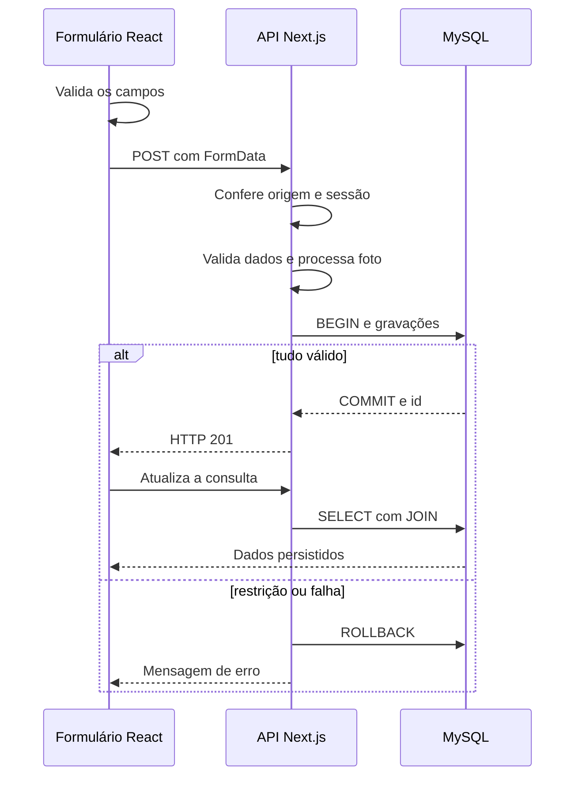

# Entenda o Elo do formulário ao banco

Leia com o projeto aberto ao lado. A melhor forma de aprender é executar um fluxo, encontrar a função responsável e fazer uma mudança pequena. Você precisa entender o que está entregando; a documentação e os commits fornecidos não representam contribuições pessoais que você ainda não fez.

## 1. Caminho de uma informação

Ao clicar **Cadastrar aluno**:

O formulário não fala diretamente com MySQL. O navegador não recebe senha do banco, driver SQL nem hash de login. Tudo isso permanece no servidor.

## 2. Como começar a leitura

| Ordem | Arquivo                                                     | O que procurar                                             |
| ----- | ----------------------------------------------------------- | ---------------------------------------------------------- |
| 1     | `package.json`                                              | Dependências e comandos: dev, build, setup e testes.       |
| 2     | `database/schema.sql`                                       | Entidades, PK, FK, UNIQUE, ENUM e CHECK.                   |
| 3     | `scripts/setup-db.mjs` e `seed.mjs`                         | Como a base nasce e como os dados fictícios são inseridos. |
| 4     | `src/lib/types.ts` e `validation.ts`                        | Contratos TypeScript e regras Zod em execução.             |
| 5     | `src/lib/db.ts`                                             | Pool de conexões e execute com parâmetros.                 |
| 6     | `src/lib/auth.ts` e rotas `api/auth/`                       | Hash de senha, token de sessão, cookie e logout.           |
| 7     | `src/lib/http.ts`                                           | Respostas JSON, códigos HTTP, origem e erros seguros.      |
| 8     | `src/lib/students.ts`                                       | Leitura multipart, processamento da foto e transação.      |
| 9     | `src/app/api/students/` e `classes/`                        | CRUD e filtros que chegam do cliente.                      |
| 10    | `src/components/carometro.tsx`                              | Estado de tela, busca, paginação e abertura de modais.     |
| 11    | `student-form.tsx`, `class-form.tsx`, `student-profile.tsx` | Formulários, seleção de imagem, edição e perfil.           |
| 12    | `ui.tsx`, `shell.tsx`, CSS e demais páginas                 | Diálogos, navegação, feedback e identidade visual.         |
| 13    | `tests/`                                                    | Como demonstrar que as regras funcionam.                   |

## 3. JavaScript, TypeScript e React

**`const` e `let`:** `const` impede reatribuir a variável; não torna um objeto imutável. `let` permite reatribuição. Objetos guardam pares chave/valor, arrays guardam sequências. `map` produz uma nova sequência (por exemplo, um botão por aluno); `filter` mantém somente elementos que atendem à condição.

**Desestruturação:** `const { input, photo } = resultado` pega duas propriedades de um objeto. `[classes, setClasses] = useState([])` pega dois itens de uma sequência retornada pelo React. `...options` copia propriedades de outro objeto; as que aparecem depois sobrescrevem as anteriores.

**`?.`, `??` e `!`:** `student?.full_name` evita acessar uma propriedade quando student é nulo/undefined. `value ?? '—'` usa o fallback somente para nulo/undefined, preservando zero. O `!` depois de uma expressão TypeScript afirma que o programador sabe que não é nula; não cria uma validação em execução. `if (!value)` usa o operador lógico de negação, outra finalidade.

**Tipos:** `Student`, `Classroom` e `Stats` descrevem formatos. `Student | null` permite um aluno ou ausência de aluno. `Promise<T>` significa que o valor chegará depois. `rows<Student>()` usa um genérico para descrever o retorno; o driver continua recebendo SQL normal. TypeScript não confere um JSON vindo da internet: por isso Zod continua necessário.

**Componente:** função que retorna JSX. Propriedades (_props_) passam dados e funções de um componente pai para um filho. `StudentForm` recebe as turmas e um callback `onSaved`; ao salvar, avisa o pai para atualizar a lista e fechar a janela.

**`'use client'`:** permite estado e eventos no navegador. Não é permissão para acessar o banco. Arquivos de rotas API e layouts assíncronos executam no servidor. `src/lib/client.ts` só usa `fetch`; `src/lib/db.ts` usa mysql2 e nunca é importado por componentes de cliente.

**`useState`:** guarda algo que muda na tela. Exemplo: `profile=null` significa nenhum perfil aberto; `setProfile(aluno)` abre o perfil desse aluno. `setRevision(v => v + 1)` força as consultas dependentes a rodarem de novo após gravar.

**`useEffect`:** executa quando suas dependências mudam. No carômetro há um efeito para o debounce, outro para alunos e outro para turmas/indicadores. O array de dependências diz quando o efeito deve repetir. A função retornada é a limpeza do efeito.

**AbortController:** cancela uma consulta antiga quando os filtros mudam ou o componente sai da tela. Sem isso, a resposta lenta da busca anterior poderia substituir a resposta mais nova. O tratamento ignora `AbortError`, pois cancelar uma busca antiga é esperado.

**`useCallback`:** mantém a mesma referência da função `closeToast` entre renderizações. Isso evita reiniciar o temporizador do aviso sem necessidade.

**`useRef`:** guarda uma referência ao elemento `<dialog>` sem precisar redesenhar a tela. `showModal()` abre o diálogo nativo com foco preso dentro dele; `close()` fecha. A tecla Esc fecha quando não há uma operação em andamento. O React remove o componente ao limpar o estado do modal.

## 4. Assíncrono e HTTP

`async` marca uma função que devolve uma Promise. `await` aguarda a conclusão sem bloquear o servidor inteiro. Consultar banco, ler um upload e processar imagem são operações assíncronas. `Promise.all` aguarda operações independentes (turmas e indicadores) juntas.

`try` contém a operação; `catch` trata uma falha; `finally` libera recursos mesmo quando algo falha. Liberar a conexão no `finally` é essencial: conexões esquecidas esgotam o pool.

| Método             | Endereço                  | Ação                                                        |
| ------------------ | ------------------------- | ----------------------------------------------------------- |
| POST               | `/api/auth/login`         | Valida e-mail/senha e cria sessão.                          |
| POST               | `/api/auth/logout`        | Apaga a sessão atual.                                       |
| POST               | `/api/auth/demo`          | Opcional, só com DEMO_ACCESS=true; acesso à conta fictícia. |
| GET                | `/api/students`           | Lista com busca, filtros, ordenação e página.               |
| POST               | `/api/students`           | Cadastra aluno, com foto opcional.                          |
| GET                | `/api/students/:id`       | Consulta um perfil.                                         |
| PUT                | `/api/students/:id`       | Edita dados e foto.                                         |
| DELETE             | `/api/students/:id`       | Exclui aluno.                                               |
| GET                | `/api/students/:id/photo` | Retorna bytes WebP após autenticação.                       |
| GET / POST         | `/api/classes`            | Lista / cria turmas.                                        |
| GET / PUT / DELETE | `/api/classes/:id`        | Consulta / edita / exclui turma.                            |
| GET                | `/api/stats`              | Totais reais do banco.                                      |

Rotas com `[id]` usam uma parte variável da URL. No Next atual, `params` e `cookies()` são assíncronos; precisam de `await`. O id vem como texto e passa por validação antes da consulta.

**JSON** é texto estruturado para enviar campos. **FormData** permite campos e um arquivo na mesma requisição. Ao enviar FormData, não definimos Content-Type manualmente: o navegador acrescenta o delimitador multipart correto.

**Códigos:** 200 sucesso; 201 criado; 400 conteúdo malformado; 401 sem sessão/login incorreto; 403 origem proibida; 404 registro inexistente; 409 conflito de integridade; 413 corpo/foto grande; 422 campos inválidos; 429 tentativas demais; 503 banco indisponível; 500 falha interna genérica.

A resposta de sucesso é `{ data: ... }`; a de falha é `{ error: { message, fields } }`. `request<T>()` no cliente confere o status antes de usar o retorno. Se a sessão terminou, leva ao login.

## 5. Banco e transações

**Pool:** um conjunto limitado de conexões reutilizáveis. Reduz o custo de reconectar em cada clique. O pool fica no `globalThis` do processo para não ser recriado a cada atualização de código no desenvolvimento.

**Prepared statement:** `execute('... WHERE id=?', [id])` envia comando e valor separadamente. Um texto com aspas ou SQL dentro do valor não vira comando. Nomes de tabelas e ORDER BY não são valores; não podem ser protegidos só com `?`. Por isso o banco configurado aceita apenas um conjunto restrito de caracteres e a ordenação vem de `studentSorts`.

**INNER JOIN:** alunos sempre têm turma; consultar alunos junto às turmas recupera nome/curso sem duplicar essas colunas. **LEFT JOIN:** a listagem de turmas precisa mostrar também turmas com zero alunos.

**PK:** identifica uma linha. **FK:** vincula a outra tabela. **UNIQUE:** impede duplicidade. **INDEX:** ajuda o banco a localizar/ordenar registros; não garante que toda busca parcial seja rápida. **CHECK:** rejeita valores fora da regra.

**Transação:** conjunto de gravações que precisa ser confirmado como uma unidade. `beginTransaction()` inicia; `commit()` confirma; `rollback()` desfaz. Em `saveStudent`, alterar dados, remover/substituir foto e confirmar acontecem na mesma conexão. A chamada a `findStudent` é leitura, não parte da gravação.

`FOR UPDATE` bloqueia a linha durante a transação. No login impede que várias tentativas simultâneas contornem o contador do mesmo e-mail. Ao editar aluno, garante que o registro ainda existe enquanto é atualizado.

**Paginação:** conta os registros com os filtros, calcula páginas e seleciona 12 por vez. `OFFSET=(página-1)*12`. A ordenação inclui o id como desempate para resultados consistentes. Se excluir o último aluno da última página, o servidor ajusta a página efetiva para a última que ainda existe.

## 6. Login sem mistério

1. O seed cria um sal aleatório e aplica `scrypt(senha,sal,64)`. Sal e resultado ficam em `users.password_hash`.
2. O login normaliza o e-mail e registra uma tentativa na janela de 15 minutos.
3. Consulta o usuário e calcula scrypt novamente. `timingSafeEqual` compara sem parar no primeiro byte diferente. Mesmo para e-mail inexistente o custo criptográfico é feito.
4. Se válido, cria um token aleatório de 32 bytes. O cookie guarda o token; o MySQL guarda apenas seu SHA-256.
5. `HttpOnly` impede ler o cookie via JavaScript de página. `SameSite=Strict` restringe o envio entre sites. `Secure` é opcional por configuração porque localhost usa HTTP.
6. A cada chamada protegida, o hash do token é procurado em sessions com expiração válida, usando `JOIN users`.
7. Sair exclui a linha no banco e o cookie. Copiar o token antigo não faz a sessão reviver depois do logout.

**Por que scrypt na senha e SHA-256 na sessão?** Senhas humanas têm baixa entropia: precisam de uma derivação cara. Tokens já são longos e aleatórios: um hash rápido basta para não guardar o token original no banco.

A comparação de `Origin` com protocolo/Host impede gravações iniciadas por outro site. Todo endpoint que altera dados verifica origem. Isso complementa SameSite, não substitui autenticação. A proteção é pensada para localhost direto; reverso/HTTPS em produção exigiria configuração apropriada.

## 7. Fotos

O formulário confere tipo e tamanho para feedback rápido. A API repete a validação e decodifica o conteúdo com Sharp. Um arquivo de texto renomeado para JPG é recusado. Há limite de 20 milhões de pixels para reduzir consumo de memória.

A imagem é orientada corretamente, reduzida a uma caixa de 800×800 sem aumentar originais pequenos, normalizada para WebP e salva em `student_photos`. O nome do arquivo não vira caminho do servidor, evitando usar caminhos enviados pelo cliente. Metadados não são preservados.

O navegador cria uma URL temporária com `URL.createObjectURL` apenas para a prévia do upload; `revokeObjectURL` libera a memória. Não é armazenamento persistente. A foto só persiste após o servidor responder com sucesso.

A listagem consulta apenas a existência da foto; os bytes são buscados por uma URL protegida. Sem foto, usa `/avatars/N.svg`. `updated_at` vai como versão na URL e a resposta tem `no-store`, evitando mostrar uma foto antiga depois de editar.

## 8. Todos os componentes

| Componente            | Estado / função principal                                             |
| --------------------- | --------------------------------------------------------------------- |
| `shell.tsx`           | Navegação pelo pathname, dados da conta e logout.                     |
| `login.tsx`           | Campos de acesso, mostrar senha, erro e estado ocupado.               |
| `carometro.tsx`       | Filtros, resultados, modo de exibição e qual modal está aberto.       |
| `classes.tsx`         | Consulta das turmas, busca local e modais de criação/edição/exclusão. |
| `student-form.tsx`    | Valores iniciais, arquivo, prévia, ilustração, remover foto e submit. |
| `class-form.tsx`      | Validação da turma e envio de JSON.                                   |
| `student-profile.tsx` | Apresentação dos dados e ações de editar/excluir.                     |
| `confirm-delete.tsx`  | Nome explícito do registro, confirmação e DELETE.                     |
| `ui.tsx`              | Modal nativo, campo, mensagem, badge, spinner e toast reutilizáveis.  |

**Campos controlados:** busca e login usam `value`/`onChange`. **Não controlados:** formulários de cadastro usam `defaultValue` e são lidos no submit por FormData. Isso reduz estados repetidos para cada campo; a validação continua centralizada.

Não renderizamos nomes com `dangerouslySetInnerHTML`. O React trata texto normalmente. Botões mostram estado ocupado e são desabilitados durante salvamento para evitar envios repetidos. A FK/UNIQUE continua sendo a proteção final caso duas requisições cheguem juntas.

## 9. Arquivos de execução e estilo

`next.config.ts` retira o cabeçalho de framework e adiciona proteção contra MIME sniffing, enquadramento por outros sites e uso de câmera/microfone/geolocalização. `globals.css` define variáveis de cores, layout, componentes, breakpoints, foco de teclado, movimento reduzido e impressão. Classes CSS não fazem consultas ao banco.

`scripts/dev.mjs` inicia o Next com o Node atual. Aceita tanto `--host` quanto `--hostname`, normaliza o argumento e propaga Ctrl+C. O modo padrão permite acesso pela rede local. `compose.yaml` roda somente MySQL e persiste a base em volume; o app continua sendo Next local.

Os CMDs procuram Node e chamam os mesmos comandos npm descritos no README. Eles não fazem uma versão paralela do aplicativo. `package-lock.json` registra versões exatas para `npm ci` reproduzir a instalação.

## 10. Exercícios para dominar de verdade

1. Explique em voz alta onde o dado está em cada etapa: estado da tela, corpo HTTP, variável do servidor e linha MySQL.
2. Mude uma cor no `:root`, uma legenda e um placeholder; confirme o efeito no navegador.
3. Adicione um teste que prove que nome só com espaços é recusado.
4. Crie uma turma, dois alunos e transfira um aluno. Explique por que a contagem muda sem uma coluna manual de total.
5. Tente uma matrícula duplicada, veja o status 409 em Network e localize o catch que traduz o erro.
6. Descreva o que mudaria para adicionar um novo campo: schema, tipos, validação, formulário, consultas, seed e teste.
7. Depois de entender, implemente uma melhoria pequena por conta própria e registre um commit com sua explicação.

Não memorize apenas a tela. Use o roteiro de perguntas de `APRESENTACAO.md` para treinar decisões, limitações e erros possíveis.
